# Evidências — Caso 01: Bad Peer AS

## Galeria cronológica

### 01 — Baseline Matriz
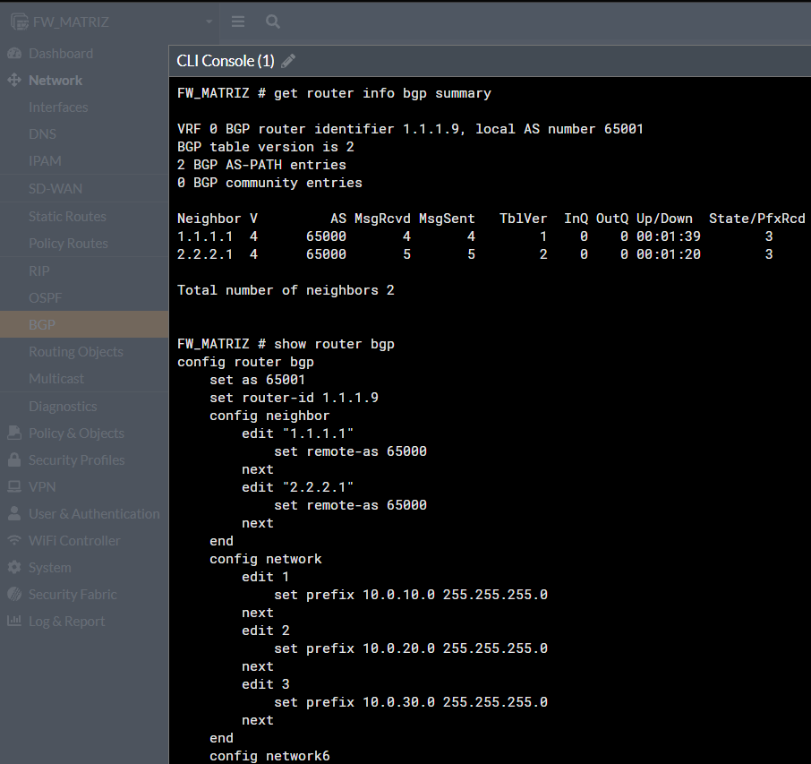

### 02 — Baseline RJ
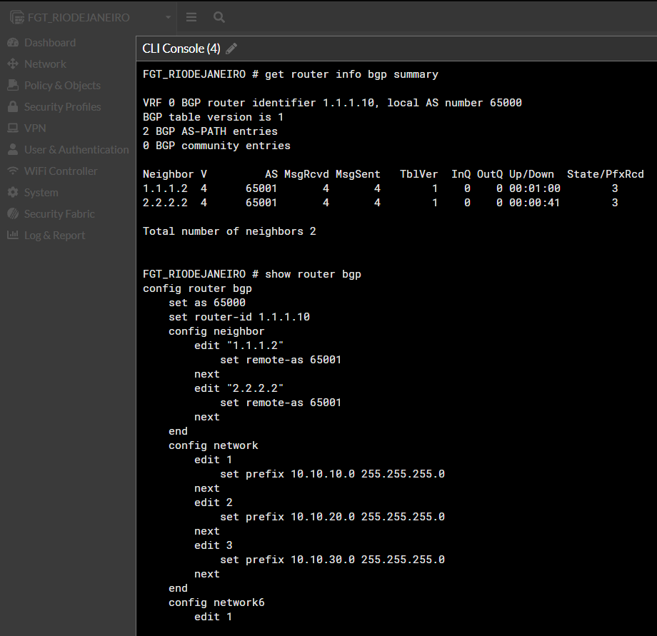

### 03 — Rotas BGP RJ
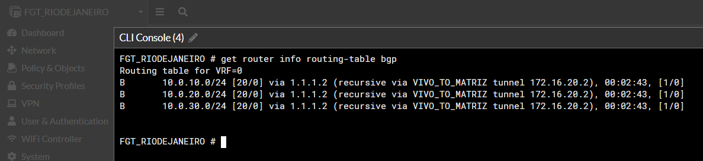

### 04 — Rotas BGP Matriz
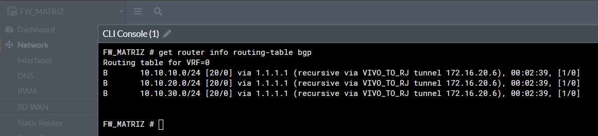

### 05 — Sessão em Idle na Matriz
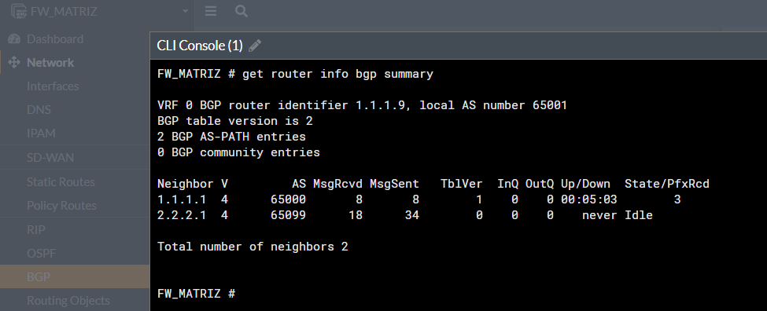

### 06 — Sessão em Idle no RJ
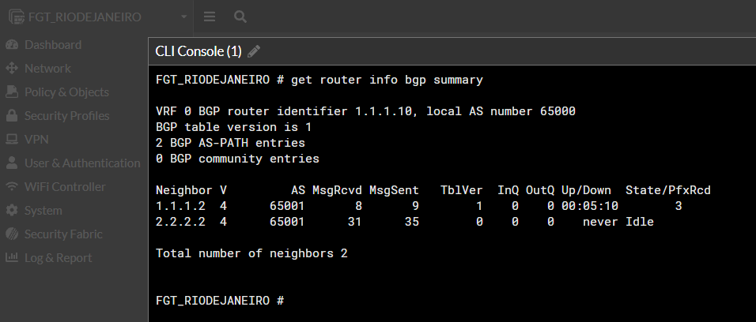

### 07 — Erro no detalhe do vizinho
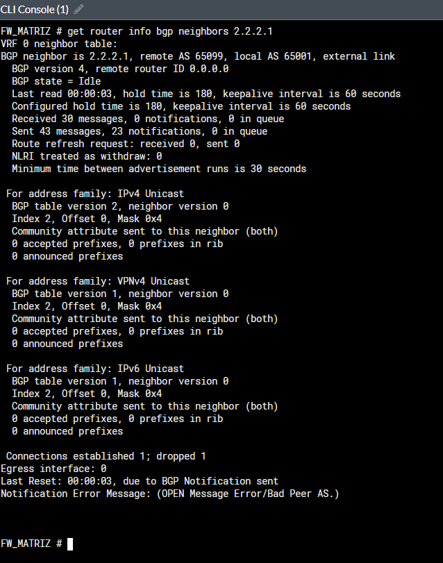

### 08 — Debug: erro destacado
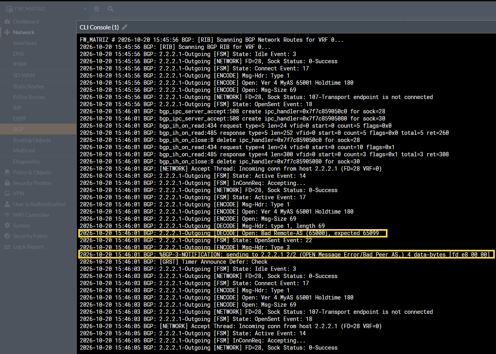

### 09 — Correção
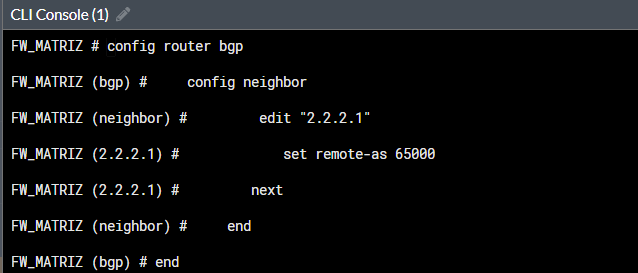

### 10 — Sessões recuperadas
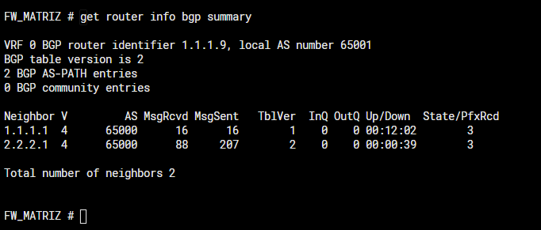

### 11 — Prefixos do neighbor recuperado
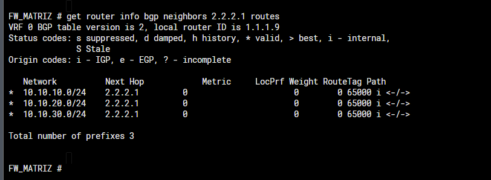

[← Voltar ao guia](README.md) · [Análise do Caso 01](CENARIOS/01-bgp-bad-peer-as.md)

---

# Caso 02 — Neighbor com IP incorreto

**Registro:** 21/10/2026 — arquivos PNG para envio na pasta `evidencias/lab02/`.

| Nº | Evidência | Descrição |
|---:|---|---|
| 00 | `00-baseline-bgp-matriz.png` | Sessões normais antes da simulação |
| 01 | `01-neighbor-idle-rotas-preservadas.png` | Neighbor incorreto em Idle e rotas pela VIVO |
| 02 | `02-vpn-ipsec-status-gui-matriz.png` | Estado das VPNs pela interface gráfica |
| 03 | `03-vpn-ipsec-tunnel-summary-matriz.png` | Seletores IPsec UP e contadores via CLI |
| 04 | `04-rota-default-mgmt-ping-sem-resposta.png` | Rota default via mgmt e ICMP sem resposta |
| **05** | **`05-interface-claro-ip-remoto-correto.png`** | **Ponto em que a divergência já podia ser identificada** |
| 06 | `06-sniffer-tcp179-rj-inicia-matriz-envia-rst.png` | Handshake TCP, dados e RST enviados pela Matriz |
| **07** | **`07-debug-bgp-no-such-peer-destacado.png`** | **Debug com `No such Peer configured` destacado** |
| 08 | `08-correcao-neighbor-gui-ip-as.png` | Configuração corrigida na GUI |
| **09** | **`09-validacao-bgp-established-tres-prefixos-destacado.png`** | **Sessão recuperada e três prefixos destacados** |

### 00 — Baseline
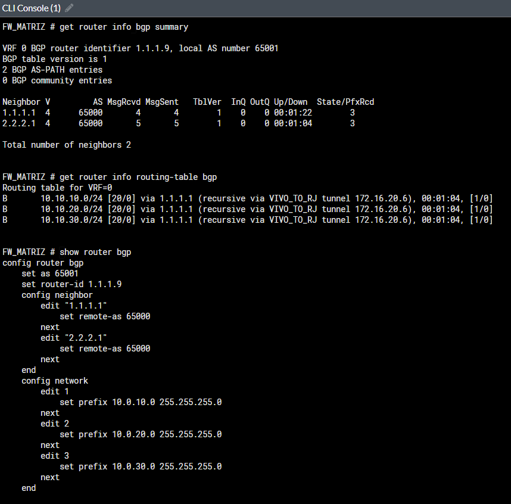

### 01 — Neighbor em Idle
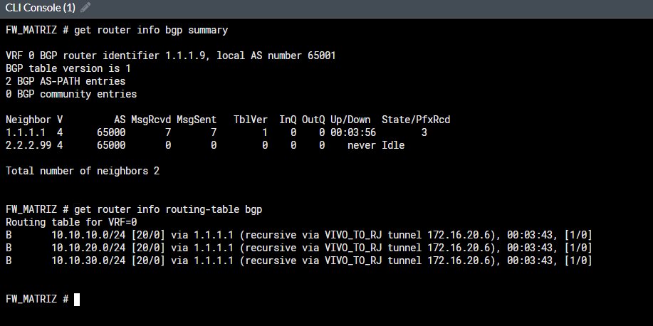

### 02 — VPNs na GUI
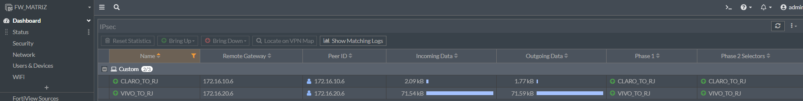

### 03 — VPNs pela CLI
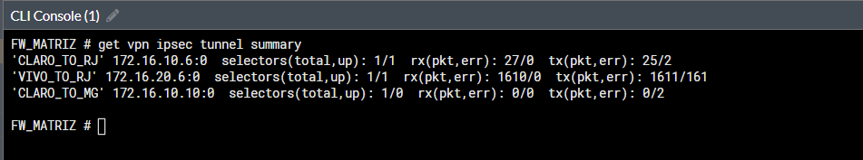

### 04 — Roteamento e conectividade
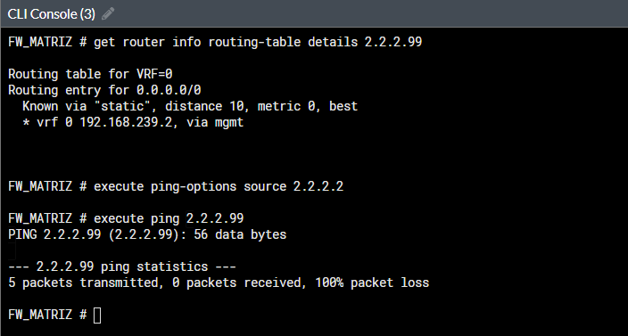

### 05 — Identificação da divergência na VPN
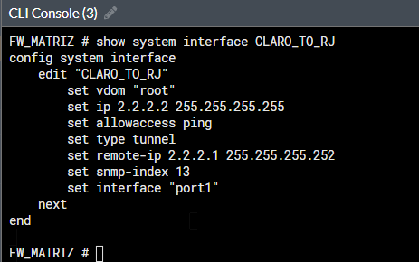

### 06 — Sniffer TCP/179
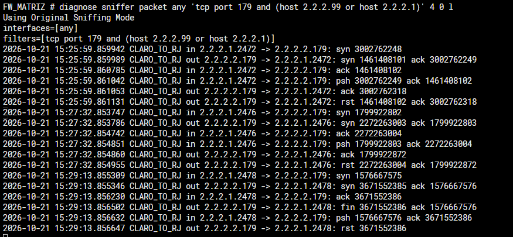

### 07 — Debug BGP destacado
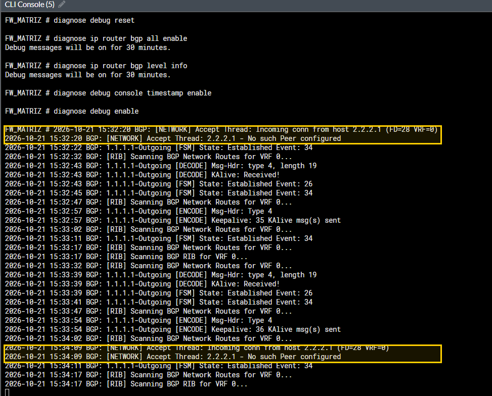

### 08 — Correção
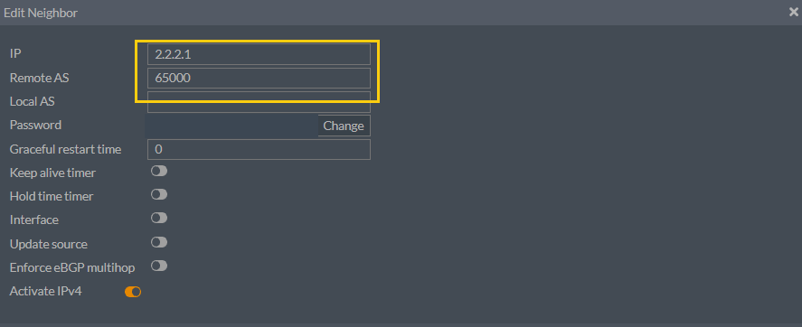

### 09 — Resultado final
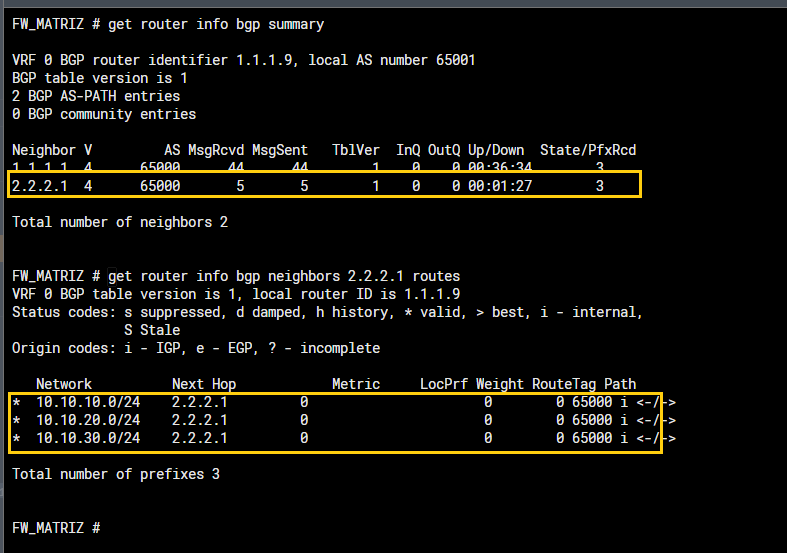

[← Voltar ao índice](README.md) · [Análise do Caso 02](CENARIOS/02-bgp-neighbor-ip-incorreto.md)
